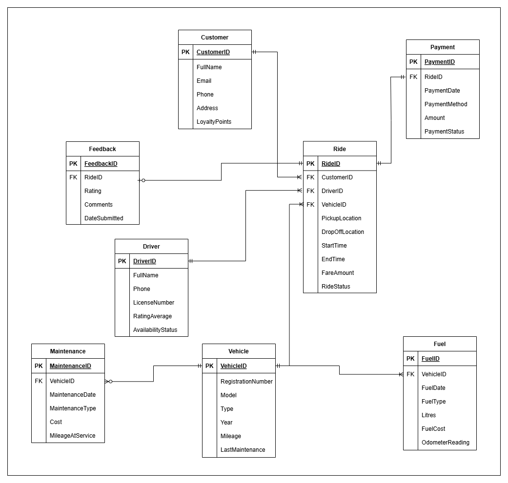
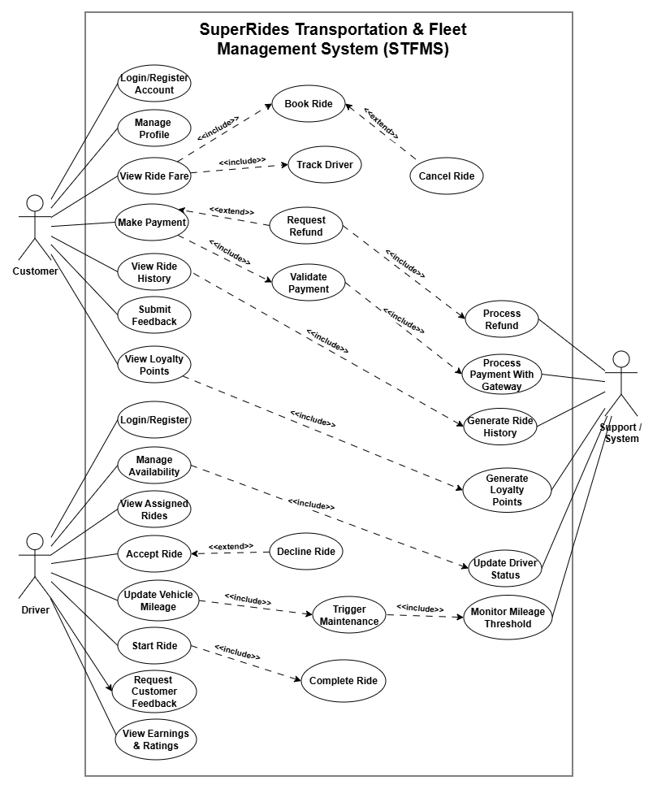

# Rideshare Database System

An Oracle SQL database project designed to model the core operations of a rideshare platform, including customers, drivers, vehicles, rides, payments, maintenance, fuel records and feedback.

## Project Overview

This project was developed as part of my BSc (Hons) Cyber Security & Networks studies.

The aim was to design and implement a relational database system capable of supporting common rideshare operations while maintaining clear relationships between customers, drivers, vehicles, rides and supporting business records.

The project includes database design, SQL implementation, sample data, complex queries, triggers, stored procedures, an entity relationship diagram, a use-case diagram and data dictionary documentation.

## Technologies Used

- Oracle SQL
- SQL DDL and DML
- PL/SQL
- Draw.io
- Relational Database Design

## Database Entities

The database contains eight main entities:

- Customer
- Driver
- Vehicle
- Ride
- Payment
- Feedback
- Maintenance
- Fuel

Additional helper tables are used for loyalty-point expiry and customer notifications.

## Database Design

The system uses primary and foreign keys to create relationships between the main entities.

Examples include:

- Customers linked to rides
- Drivers linked to rides
- Vehicles linked to rides
- Payments linked to rides
- Feedback linked to customers, drivers and rides
- Maintenance and fuel records linked to vehicles

The complete relational schema can be viewed in:

`sql/Relational-Schema.md`

## Entity Relationship Diagram

The ERD represents the main entities and relationships within the database.



The editable Draw.io source file is also available in the `diagrams` folder.

## Use-Case Diagram

The project also includes a use-case diagram representing key interactions within the rideshare system.



## SQL Files

The main database files are stored in the `sql` folder.

### DDL

`DDL.sql`

Creates the database tables, primary keys, foreign keys and other structural constraints.

### Sample Data

`Sample-Data.sql`

Contains synthetic sample data used to populate and test the database.

All names, contact details, addresses and identifiers in this file are fictional and intended solely for demonstration and database testing.

### Queries

`Queries.sql`

Contains eight SQL queries demonstrating different database operations including:

- Multiple-table joins
- Filtering
- Aggregation
- Subqueries
- GROUP BY
- HAVING
- UNION ALL
- Date-based analysis
- Driver performance analysis
- Revenue calculations
- Vehicle maintenance analysis

## Triggers and Stored Procedures

`Triggers-And-Procedures.sql`

The project includes automation using PL/SQL.

### Trigger 1

Automatically changes a driver's availability status to `Available` when a ride is completed.

### Trigger 2

Automatically creates a maintenance record when a vehicle reaches the defined maintenance mileage threshold.

### Stored Procedure

Generates customer notifications when loyalty points are due to expire within seven days.

## Query Results

Screenshots showing the results of the eight implemented queries are stored in:

`query-results/`

These demonstrate that the queries were executed against the populated database.

## Data Dictionary

The `data-dictionary` folder contains documentation screenshots for each major database entity:

- Customer
- Driver
- Vehicle
- Ride
- Payment
- Feedback
- Maintenance
- Fuel

## Project Structure

```text
rideshare-database-system/
│
├── sql/
│   ├── DDL.sql
│   ├── Sample-Data.sql
│   ├── Queries.sql
│   ├── Triggers-And-Procedures.sql
│   └── Relational-Schema.md
│
├── diagrams/
│   ├── ERD.png
│   ├── ERD.drawio
│   ├── Use-Case.png
│   └── Use-Case.drawio
│
├── data-dictionary/
│   ├── Customer.png
│   ├── Driver.png
│   ├── Feedback.png
│   ├── Fuel.png
│   ├── Maintenance.png
│   ├── Payment.png
│   ├── Ride.png
│   └── Vehicle.png
│
├── query-results/
│   ├── Query 1.png
│   ├── Query 2.png
│   ├── Query 3.png
│   ├── Query 4.png
│   ├── Query 5.png
│   ├── Query 6.png
│   ├── Query 7.png
│   └── Query 8.png
│
└── README.md
```

## What I Learned

Through this project I developed practical experience in:

- Relational database design
- Creating entity relationships
- Primary and foreign key implementation
- Oracle SQL
- Writing DDL and DML
- Developing complex SQL queries
- Using joins and subqueries
- SQL aggregation and reporting
- Designing triggers
- Writing stored procedures
- Creating database diagrams
- Structuring and documenting a complete database project

## Future Improvements

Possible future developments could include:

- Additional validation constraints
- Database views
- More advanced stored procedures
- Role-based access control
- Audit logging
- Improved reporting queries
- Integration with a web or mobile application

## Author

**Muhammad Shawaiz Jamal**  
BSc (Hons) Cyber Security & Networks

[LinkedIn](https://www.linkedin.com/in/muhammad-shawaiz-jamal/)
